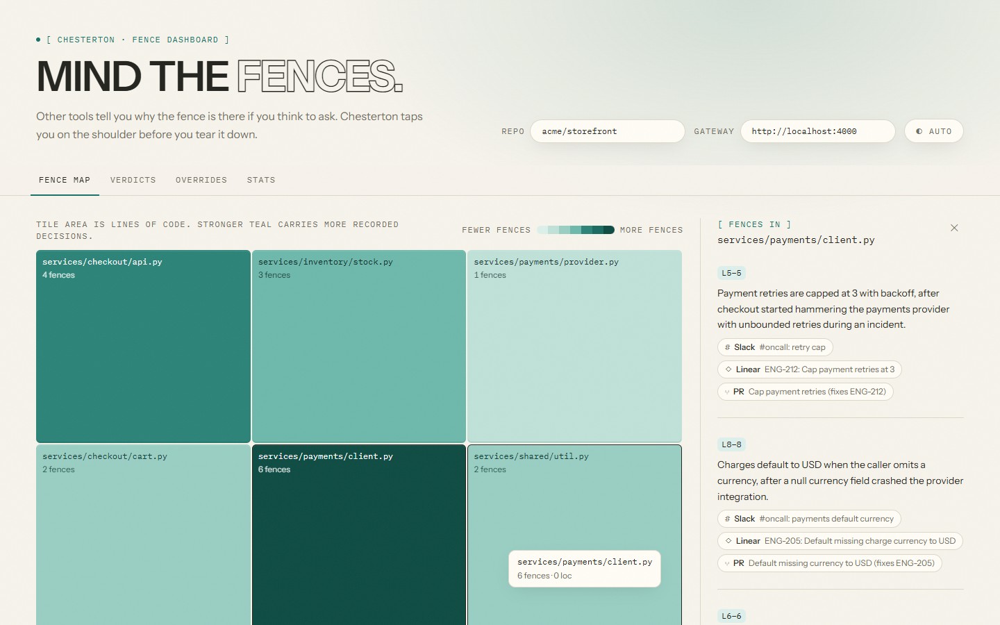

# Chesterton

> Other tools tell you why the fence is there if you think to ask. Chesterton taps you on the shoulder before you tear it down.

Code often exists for a reason recorded somewhere else: an incident Slack thread, a Linear
ticket, an old PR. The developer changing that code usually doesn't know the reason exists, so
they never look it up. On every PR, Chesterton finds changed lines that have a recorded reason
behind them, asks [Estelle](#mock-vs-real-mode) whether the change contradicts that reason, and —
only when there's explicit evidence — flags it inline on github.com with citations (the Slack
thread, the Linear ticket, the original PR). If there's no evidence, it stays silent. No guesses.
A second mode flags code comments a PR makes stale.

Built for the Fate Labs "Best use of Estelle" track. Full product narrative: [`docs/outline.md`](docs/outline.md).
Build plan and phase breakdown: [`docs/build_plan.md`](docs/build_plan.md).
Service contracts (ports, env vars, JSON shapes): [`docs/contracts.md`](docs/contracts.md).

## How it works

1. A developer opens or updates a PR. GitHub sends a webhook to the Node **gateway**.
2. The Rust **diff analyzer** splits the diff into hunks and maps them to symbols and line history.
3. The Python **triage** service scores each hunk; only safeguard-like changes (removed
   conditionals, changed numeric constants, dropped retries/timeouts) move on.
4. The Go **verdict** service asks Estelle, per hunk: is there a recorded reason for these lines,
   and does this change contradict it?
5. The verdict is cached in **Redis** and stored in the Spring Boot **ledger** (Postgres).
6. Verdict posts a GitHub check run with the result and citations.
7. The browser **extension** reads the verdicts and pins flags beside the exact lines in the PR
   diff view.
8. A reviewer can dismiss a flag or override it with a reason. The override becomes new memory
   cited by future PRs.

## Architecture

| Component | Tech | Role |
|---|---|---|
| Browser extension | TypeScript, HTML/CSS (MV3) | Injects inline flags into the github.com PR diff view |
| Gateway | Node.js (TS), REST | Receives GitHub/Slack/Linear webhooks; single API for the extension and dashboard |
| Diff analyzer | Rust (axum) | Parses diffs, maps hunks to symbols and line ranges, tracks lines across commits |
| Hunk triage | Python (FastAPI) | Rule-based scoring of which hunks look like removed safeguards, so only those go to Estelle |
| Verdict service | Go | Queries Estelle for each flagged hunk concurrently, applies strictness rules, posts the GitHub check run |
| Decision ledger | Spring Boot + PostgreSQL | Stores verdicts, citations, overrides and reviewer feedback; powers the accuracy stat |
| Cache | Redis | Verdicts keyed by PR head SHA + hunk hash, so the same input always returns the same answer |
| Raw events | MongoDB | Raw webhook payloads from GitHub, Slack and Linear (file-fallback if absent) |
| Dashboard | React + TypeScript | Fence map treemap (tiles shaded by fence count; area sizing by LOC is future work — `loc` is currently always 0), verdict history, override log, false-positive rate |
| Plaque service | Node.js + GitHub REST API | Turns a "Pin reason" click into a suggested-change review comment on the PR |
| Code agent | Estelle | Indexes the repo and cited memory; answers whether a change contradicts a recorded reason |
| CI/CD | GitHub Actions | Builds and tests every service |
| Infra | Docker Compose | One-command local stack |

Mocks (`mocks/`) emulate Estelle, the GitHub API, Slack and Linear for local development and the
demo, so the whole pipeline runs without any external credentials — see
[Mock vs. real mode](#mock-vs-real-mode).

## Quickstart

### First-time setup

On a fresh clone, each service's own dependencies need installing before `node e2e/run.mjs` below
will work (every service manages its own `node_modules`/venv — there's no root install):

```bash
(cd mocks && npm install)
(cd gateway && npm install)
(cd dashboard && npm install)   # --keep-alive now boots the dashboard too (see below)

# seed needs PyYAML:
pip install pyyaml              # or create a venv first: python -m venv .venv && .venv/bin/pip install pyyaml

# triage needs its own venv (e2e/run.mjs looks for it at triage/.venv and falls back to the
# system python/python3 on PATH, with a log line, if it isn't there):
python -m venv triage/.venv
triage/.venv/bin/pip install -r triage/requirements.txt       # macOS / Linux
triage\.venv\Scripts\pip install -r triage\requirements.txt   # Windows
```

### Bare metal (fastest; what the demo uses)

Requires Node 22+, Python 3.13, Rust (cargo), Go 1.26+, and a JDK 21 (via the included Maven
wrapper). From the repo root:

```bash
node e2e/run.mjs
```

This seeds the demo world, builds the Rust/Go binaries, boots every service (mocks, triage,
diff-analyzer, verdict, gateway, and — unless `SKIP_LEDGER=1` — the ledger), fires the three
demo PRs through the mock GitHub trigger, and asserts the outcomes documented in
`docs/contracts.md`. Exits 0 on all-green, tearing every service down.

To leave the stack running afterwards (e.g. to drive the demo or poke at the APIs by hand), add
`--keep-alive`. On a pass, this also boots the **dashboard** (`npm run dev`, vite, port 4600) —
it's intentionally not part of the assertion phase above, only of the demo-ready stack:

```bash
node e2e/run.mjs --keep-alive   # Ctrl+C to stop everything, including the dashboard
```

Or use the demo wrapper, which does the same thing and also prints the browser tabs to open (see
[Demo script](#demo-script)):

```bash
./scripts/demo.sh        # bash / Git Bash / macOS / Linux
./scripts/demo.ps1       # PowerShell
```

### Docker Compose

Requires Docker with Compose v2. Brings up Postgres, Redis, MongoDB, and every service, wired
together with the env vars from `docs/contracts.md` (service names as hostnames instead of
`localhost`):

```bash
docker compose -f infra/docker-compose.yml up --build
```

The `seed` service is a one-shot init job: it runs `seed.py --reset` into a shared volume before
`mocks` starts (`depends_on: condition: service_completed_successfully`). Re-seed at any time
with:

```bash
docker compose -f infra/docker-compose.yml run --rm seed
```

Validate the compose file without a running daemon:

```bash
docker compose -f infra/docker-compose.yml config
```

Once up, the same ports are published to the host as bare metal (gateway `4000`, mocks `4100`,
diff-analyzer `4200`, verdict `4300`, ledger `4400`, triage `4500`, dashboard `4600`), so the
extension and the demo tab list work identically against either deployment.

The extension is **not** dockerized (browser extensions aren't containers) — load it per
[below](#loading-the-extension).

## Mock vs. real mode

`CHESTERTON_MODE=mock` (the default) emulates Estelle, GitHub, Slack and Linear with the local
`mocks/` service, so the entire pipeline — webhook, diff analysis, triage, verdict, check run,
inline flag — runs deterministically with zero external credentials. `CHESTERTON_MODE=real`
switches base URLs to the real APIs; every service is written against the same HTTP contracts in
both modes (see `docs/contracts.md`).

**Status: hybrid mode is built and verified live** — a real GitHub App posts real check runs on
[the real demo repo](https://github.com/tiffany-mares/chesterton-demo-storefront) via live
webhooks (Cloudflare Tunnel), with citations resolving to a real Slack workspace and real Linear
tickets; only Estelle itself still runs as the mock, pending credentials. Boot commands, the
tunnel/webhook procedure, state resets, and every known gotcha live in
**[docs/runbook.md](docs/runbook.md)** — read that before demo day.

### Credential checklist for real mode

This is the Phase-0 checklist from `docs/build_plan.md`. Items are checked off as they were
completed and verified:

- [ ] **Estelle access** — confirm API access from your own services, which languages/content it
      indexes, and whether it can ingest a seeded Slack and Linear workspace (or fall back to
      GitHub-only evidence: PR discussions and Issues). *(Pending credentials; the verdict
      service's adapter is ready: `ESTELLE_URL` + `ESTELLE_API_KEY`.)*
- [ ] **Estelle reasoning** — confirm whether it can answer a contradiction question directly, or
      only retrieve. This decides how much reasoning lives in the Go `verdict` service's prompt.
- [x] **GitHub App** — `chesterton-tiffany-mares`, created via the manifest flow with the
      `pull_request` webhook, **Checks: write**, **Pull requests: write**, **Contents: read**.
      The gateway mints installation tokens itself (`GITHUB_APP_ID` / `GITHUB_APP_PRIVATE_KEY` /
      `GITHUB_APP_INSTALLATION_ID`) — check runs cannot be created with a classic PAT.
- [x] **Slack** — bot with `chat:write`, `channels:manage`, `channels:read`; it creates and posts
      the `#oncall` threads itself. `SLACK_BOT_TOKEN` + `SLACK_CHANNEL_ID`.
- [x] **Linear** — API key + `LINEAR_TEAM_ID` (`issueCreate` requires a team id). Seeding creates
      the tickets for real.
- [x] **Webhook tunnel** — Cloudflare quick tunnel verified end-to-end (GitHub delivered a live
      `synchronize` webhook through it); see the runbook for the URL-rotation procedure.

Env vars live in `.env.example` at the repo root — copy to `.env` and fill in the real-mode
section once the checklist above is done.

## Loading the extension

The extension is a plain MV3 Chrome extension, built but not published to a store:

```bash
cd extension
npm install
npm run build        # -> extension/dist/
```

Then in Chrome: `chrome://extensions` → enable **Developer mode** → **Load unpacked** →
select `extension/dist`. It activates on `https://github.com/*/*/pull/*/files*` and on the mock
GitHub pages at `http://localhost:4100/github/*/*/pull/*/files*`.

By default it reads the gateway base URL from extension storage as `http://localhost:4000`. To
point it elsewhere (e.g. a different compose host), open the extension's options page and set the
gateway URL explicitly.

## Demo script (about 3 minutes)

The 8 beats, straight from `docs/outline.md`. Run `./scripts/demo.sh` (or `demo.ps1`) first — it
boots the stack and prints the exact tab URLs for the current `seed/out`.

1. **Hook (10s)** — a one-line PR removes a retry cap. Looks harmless. Ask the room if they'd
   approve it.
2. **The catch (40s)** — open the PR. Chesterton flags the line: this cap exists because of an
   incident, citing the `#oncall` thread, the Linear ticket, and the original fix PR. Click each
   citation.
3. **The silence (20s)** — open a harmless refactor PR. No flags. Chesterton only speaks with
   evidence.
4. **Stale comment (20s)** — a PR changes a timeout constant; the comment above it still cites the
   old value. Flagged with the PR that changed the behavior.
5. **Same input, same answer (15s)** — re-run the first PR. Identical verdict and citations. This
   is the Estelle reliability point (Redis-cached by head SHA + hunk hash).
6. **Fence plaque (20s)** — click "Pin reason" on the retry-cap flag; the button flips to
   "Pinned ✓". Reload the mock PR page: the suggested comment (a `` ```suggestion `` block
   inserting the fence comment line) now renders under the file, same as GitHub would show it.
7. **Memory grows (20s)** — a reviewer overrides a flag with a reason via the extension. Open the
   dashboard's Overrides tab: the override is there, the ledger has recorded a new decision
   (source `override`) anchored to those lines, and the gateway has pushed the override into
   Estelle's knowledge (`POST /estelle/v1/knowledge`). Open a new PR touching the same lines:
   Chesterton now cites the override.
8. **Close on the fence map (25s)** — the dashboard heatmap lights up payments and checkout.
   Click the hottest tile to show its fences and citations. End on the one-liner.

Demo safety: a backup video of a full run should exist before going on stage — generate one with
`node scripts/record-demo.mjs` against a warmed mock-mode stack (writes
`docs/demo-backup/chesterton-demo-backup.mp4`, gitignored; walks the flag card, citations,
silence, stale comment, fence plaque, and dashboard beats with the extension loaded). Pre-warm
the Redis cache (the `--keep-alive` boot already fires all three demo PRs once); keep a local
fallback if Wi-Fi or webhooks fail — the whole stack runs fully offline in mock mode.

**Fence map screenshot:**



## Cut order and risks

Cut on purpose, in order, if time runs out (from `docs/build_plan.md`): Kubernetes → MongoDB (use
Postgres `jsonb`) → the PyTorch triage model (keep the rules) → fence map treemap polish (ranked
table instead) → Spring Boot ledger (fold into Node + Postgres) → stale comment mode → fence
plaque. The floor that must never be cut: PR webhook → Estelle verdict with citations → check run
→ inline flag on one planted PR.

Known risks (from `docs/outline.md`):

- **False positives destroy trust.** Only flag when the cited reason is explicit and the diff
  touches the exact lines it was about (the Go verdict service's strictness rule).
- **Only knows what was written down.** Decisions made in person are invisible to Chesterton.
- **Comparisons to similar tools** (Unblocked, Pruve, GitLens, git-why). Answer: one job, a hard
  evidence rule, and the same verdict every time.
- **GitHub DOM changes can break the extension.** The check run still shows the verdict even if
  the extension fails — it's not the only surface for the result.

## Development

Each service manages its own dependencies and tests independently; see each service's own
`README.md` (where one exists, e.g. `triage/README.md`, `seed/README.md`) and
[`docs/contracts.md`](docs/contracts.md) for details. The root `package.json` only wires the
cross-service end-to-end script:

```bash
npm run e2e              # == node e2e/run.mjs
npm run e2e -- --keep-alive
```

CI (`.github/workflows/ci.yml`) runs one job per service on every push/PR: `mocks`, `gateway`,
`extension`, `dashboard` (Node), `diff-analyzer` (Cargo), `verdict` (Go), `triage` and `seed`
(pytest), `ledger` (Maven wrapper).
